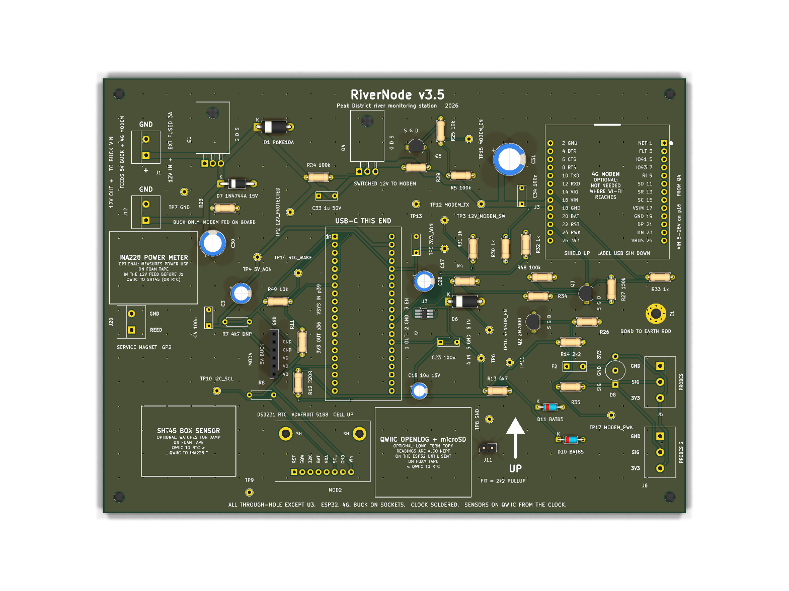

# RiverNode build files

RiverNode is a solar-powered station that records river and air temperature, and
optionally the water level, and uploads it to an open dashboard at
[rivernode.uk](https://rivernode.uk). This repository holds the files you need to make
the hardware yourself:

| Folder | What it is | Status |
|---|---|---|
| [`board/`](board/) | Main circuit board **v3.5**: gerbers, JLCPCB assembly files, board render, schematic, parts list, first power-up guide | v3a's outline and circuit, simplified: four modules on the board, sensors on Qwiic cables |
| [`enclosure/`](enclosure/) | Printed base, cover and test-fit coupon for the board | Fits v3.5, v3a and v3a.2 |
| [`radar-housing/`](radar-housing/) | Under-bridge housing for the SparkFun XM125 water-level radar, version 2 | Printable now |
| [`older-boards/`](older-boards/) | v3a.2, the previous board | Still supported |

Every part with where to buy it, the tools you need and build tips are at
[rivernode.uk/build/parts/](https://rivernode.uk/build/parts/), and help choosing a power
set-up for your site is at
[rivernode.uk/choosing-your-node/](https://rivernode.uk/choosing-your-node/). Firmware
updates reach every station over the air, by Wi-Fi or 4G.

## Recommended power for year-round monitoring

| Part | Choice |
|---|---|
| Battery | **Beyond Batteries NA10**, 10 Ah sodium-ion. Charges to 15.8 V; works from 8 to 15.8 V |
| Solar panel | **30–35 W**, giving at least 20 V at full output (Vmp). Suggested: Victron BlueSolar 30 W (36 cells, Vmp 21.2 V) or Newpowa 35 W "24 V" (Vmp about 34 V). One panel only: never two in series |
| Charge controller | **Victron SmartSolar MPPT 75/10**. It also reports the battery and solar figures to the station over Bluetooth |

Set the Victron to a **user-defined** charge profile, not the lithium preset:
absorption 15.8 V, maximum charge voltage 15.8 V, float 13.2–13.4 V, equalisation off,
temperature compensation off (Beyond Batteries' own figures for the NA10). The standard
load-output cut-off presets (11.1 V and 11.8 V) turn the station off with about 20 % and
40 % of a sodium-ion pack still left. If your controller lets you set your own, about
10.2 V leaves roughly 10 %, going by the maker's discharge table. For Bluetooth, turn on
*Instant readout* and paste the charger's encryption key into the station's set-up page.

**Why a Victron charger?** Sodium-ion needs one, because it needs its own charge profile
and the Victron lets you set every voltage. LiFePO4 works with any solar charge controller
that has a LiFePO4 setting, and lead acid with any controller, or with a solar
trickle-charger panel made to keep car batteries topped up. What the Victron adds is the
battery and solar history: the station reads its battery voltage, charge current, solar
power and daily yield over Bluetooth and uploads them, so the dashboard shows how the
battery and the charging are performing. Note that it uses more power than the node itself
(about 20 mA standing, against the board's 13 mA).

**Which battery.** Sodium-ion for year-round stations and long spells of shade or short
winter days: it charges in the cold, and its voltage shows how full it is. LiFePO4 with a
20–30 W panel for the trout season: most won't take a charge below freezing. Lead acid if
you only want the river's temperature, or at a site you visit often, where two small
batteries swapped over on each visit will do.

**Why this size.** A station measured on the bench used about 3.7 Wh a day, and the
Victron's own standby adds about 5.8 Wh, so plan on roughly 9.5 Wh a day. Running the
NA10 from 90 % down to 20 % gives about 84 Wh, which is around nine days with no useful
sun. A 30 W panel covers the daily use with under half an hour of full sun, and refills
the battery in about three bright days. The panel is chosen for its voltage as well as
its watts: the controller only starts charging once the panel is 5 V above the battery,
and a 15.8 V sodium-ion pack needs a panel with a Vmp of at least 20 V. The Victron 30 W
just clears that; a "24 V" panel has plenty of margin. A typical "12 V" panel (Vmp about
18 V) leaves the battery slightly undercharged.

## Licence

Everything here is licensed under
[Creative Commons Attribution-NonCommercial-ShareAlike 4.0](https://creativecommons.org/licenses/by-nc-sa/4.0/)
(CC BY-NC-SA 4.0). See [LICENSE](LICENSE).

You may make, change and share these designs for non-commercial use, such as building
stations for your own club or river group, as long as you credit RiverNode and share any
changes under the same licence. Selling boards, kits or stations made from them needs
permission: ask through [rivernode.uk](https://rivernode.uk).

© 2026 RiverNode.

## No warranty

These files are provided as they are, without any warranty. Check everything against
the real parts before you pay for boards, and take care with batteries, mains chargers
and anything you fix near a river. In England, fixing anything in, over or near a main
river can need a permit from the Environment Agency, and you always need the
landowner's permission.
