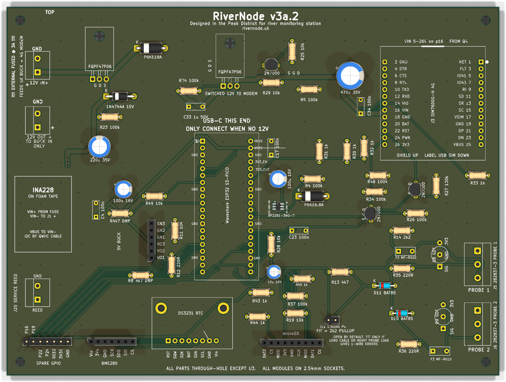

# Main board, v3a.2

**The RiverNode board, refined.** v3a.2 keeps every track of v3a, the board already built
and running, and adds what building it taught us: a screw terminal for
the service-mode reed switch, a clear 12 V path with nothing to bridge by hand, a marked
spot for the optional power meter, and corrected labels on every socket.

## What's on the board

- **ESP32-S3 controller** with Wi-Fi, and Bluetooth for reading the Victron charge controller
- **4G modem socket** (Waveshare SIM7600G-H) for sites with no Wi-Fi
- **Real-time clock** (DS3231) that wakes the station on the hour, every hour, in step with
  the Environment Agency's gauges
- **microSD card**: every reading is saved locally first, so nothing is lost when the
  signal drops
- **Two temperature probe inputs** with surge protection (gas discharge tube, resettable
  fuse and clamp diodes) on every cable that leaves the box
- **Box climate sensor** socket for temperature, humidity and pressure inside the enclosure
- **Switched power rails**: the modem, SD card and probes are switched off between readings,
  so a small solar panel keeps it going all year
- **Spare GPIO header** for adding sensors later

Every part is through-hole except one small chip (U3), and every module plugs into a
2.54 mm socket, so it is a comfortable build with a normal soldering iron and any
module can be swapped in seconds.

| File | What it is |
|---|---|
| `gerbers/` | Fabrication files for the board maker, plus `FAB_NOTES.txt` |
| `RiverNode_v3a2_render.png` | Picture of the finished board |
| `RiverNode_v3a2_board.pdf` | Board layout, layer by layer |
| `RiverNode_v3a2_schematic.pdf` | Circuit diagram |
| `RiverNode_v3a2_BOM.csv` | Parts list by reference (prices and suppliers are at [rivernode.uk/bom/](https://rivernode.uk/bom/)) |

## Ordering the board

Zip the `gerbers/` folder and upload it to any board maker (JLCPCB, PCBWay and others).

| Setting | Value |
|---|---|
| Size | 182 × 136 mm |
| Layers | 2 |
| Thickness | 1.6 mm |
| Copper | **1 oz (35 µm)** |
| Finish | HASL is fine |
| Mask and legend colour | Any. Legend on **both** sides |

The 12 V feed to the 4G modem is sized for 1 oz copper, because the modem draws up to
2.2 A in bursts, so choose 1 oz if it isn't the maker's default. The maker's own design
check (DFM) report is free and worth a look before you pay.

## Building it

- Fit the modules after the rest of the board is soldered: the controller, modem, clock,
  climate sensor, microSD card and 5 V converter all go into sockets.
- **Service-mode reed switch:** two wires to J20 (REED and GND). Hold a magnet against
  the box and the station opens its own Wi-Fi set-up page on your phone.
- **Power meter (optional):** an Adafruit INA228 measures what the whole station draws.
  It sits on foam tape in the marked area, wired into the 12 V feed as printed there
  (VIN+ from the fuse, VIN− to J1 +, VBUS to VIN−), and joins the sensor bus with a Qwiic
  cable.
- **Long probe cables:** if they give 1-Wire errors, fit the jumper J11 for a stronger pull-up.

**Sodium-ion batteries.** The input surge protector D1 is rated to 15.3 V continuous.
A sodium-ion pack charging at 15.8 V sits a little above that, well below the 17.1 V
where it starts to conduct. If you prefer to keep it fully within rating, set the
charger's absorption voltage to 15.3 V.

## Firmware

The station firmware is not in this repository yet. Get in touch through
[rivernode.uk](https://rivernode.uk) and we'll help you get a board running.
