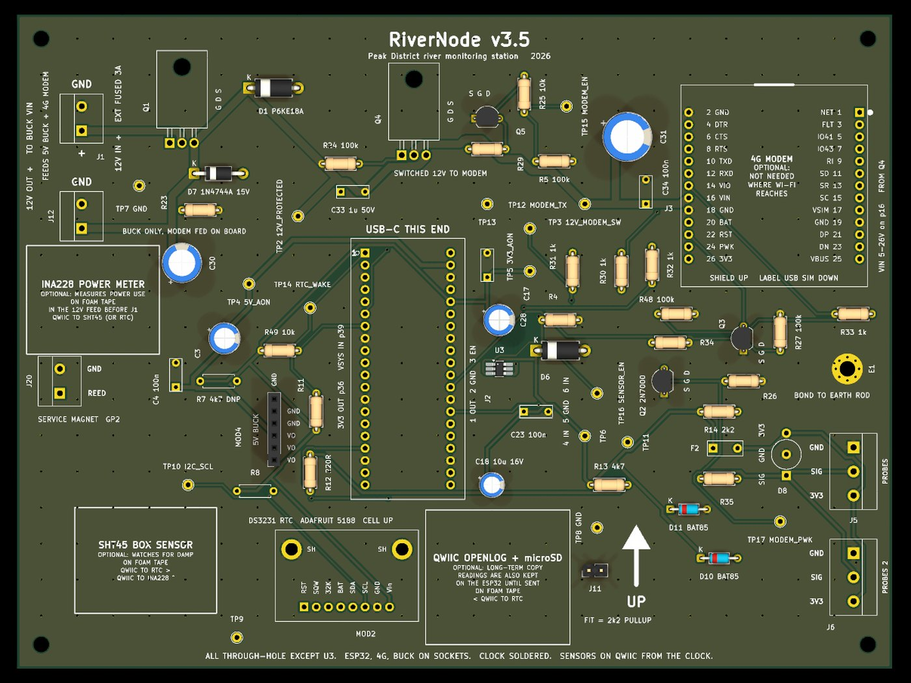

# Main board, v3.5

**The RiverNode board, simplified.** v3.5 keeps v3a's outline, mounting holes and
proven circuit. Only four modules sit on the board itself: the controller, the 4G modem,
the 5 V supply and the clock. Everything else joins by Qwiic cable, so the soldering is
simpler, and any sensor swaps in seconds.

## What's on the board

- **ESP32-S3 controller** (Waveshare ESP32-S3-Pico) with Wi-Fi, and Bluetooth for reading
  the Victron charge controller
- **4G modem socket** (Waveshare SIM7600G-H), *optional*: not needed where Wi-Fi reaches
- **5 V supply** for the controller, in a socket
- **Real-time clock** (Adafruit DS3231, STEMMA QT version), soldered straight in. It wakes
  the station on the hour, every hour, in step with the Environment Agency's gauges, and
  its two Qwiic sockets start the sensor chain
- **Two probe screw terminals**, J5 and J6, wired in parallel behind one surge-protection
  chain (gas discharge tube, resettable fuse and clamp diodes): one probe in each, or both
  in J5 with J6 as a spare
- **An earth stud** (E1) for a wire to an earth rod
- **Printed outlines** showing where each Qwiic module sits on foam tape, how it chains to
  the clock, and why it is optional:
  - SHT45 box sensor: watches the box for damp
  - SparkFun Qwiic OpenLog with a microSD card: a long-term copy of every reading
    (readings are already held on the controller until they are sent)
  - Adafruit INA228 power meter: measures what the station draws
- **Switched power rails**: the modem and probes are switched off between readings,
  so a small solar panel keeps it going all year

Every part is through-hole except one small chip, U3. JLCPCB can fit that for you (see
below).

| File | What it is |
|---|---|
| `gerbers/` | Fabrication files for the board maker, plus `FAB_NOTES.txt` |
| `RiverNode_v3.5_BOM_JLCPCB.csv`, `RiverNode_v3.5_CPL_JLCPCB.csv` | Assembly files, only if you want JLCPCB to fit U3 (LCSC C128634) |
| `RiverNode_v35_BOM.csv` | Every part on the board, by reference |
| `RiverNode_v3.5_board_2026-11-27.jpg`, `RiverNode_v35_render.png` | Pictures of the board |
| `RiverNode_v35_board.pdf` | Board layout, layer by layer |
| `RiverNode_v35_schematic.pdf` | Circuit diagram |
| `FIRST_POWER_UP.pdf` | Step-by-step first power-up, one module at a time, with the readings to expect |
| `SOCKET_CHECK_SHEET.pdf` | Print at 100% and lay each module on it to check its pin order |
| `FIT_CHECK_1to1.pdf` | The whole board at 1:1, to check parts against before ordering |

Every part, with where to buy it, plus the tools and build tips, is at
[rivernode.uk/build/parts/](https://rivernode.uk/build/parts/).

## Ordering the board

Zip the `gerbers/` folder and upload it to any board maker (JLCPCB, PCBWay and others).

| Setting | Value |
|---|---|
| Size | 182 × 136 mm |
| Layers | 2 |
| Thickness | 1.6 mm |
| Copper | **1 oz (35 µm)** |
| Finish | HASL is fine |
| Mask and legend colour | Any. Legend on **both** sides |

The 12 V feed to the 4G modem is sized for 1 oz copper, because the modem draws up to
2.2 A in bursts, so choose 1 oz if it isn't the maker's default. The maker's own design
check (DFM) report is free and worth a look before you pay.

To have JLCPCB fit U3, turn on assembly and upload the two `_JLCPCB.csv` files. Check U3's
rotation in their preview: pin 1 goes by the dot.

## Building it

- **Practise first.** A bad joint can send you down hours of false trails. Pads joined to
  the ground plane need a little more heat.
- Solder the low parts first, then the sockets and terminals, then the tall capacitors.
- **Clock:** solder the Adafruit DS3231 STEMMA QT (5188) straight into MOD2 on its own pin
  header, coin cell (CR1220) facing up. Its Qwiic sockets are edge-mounted underneath, so
  the cables still plug in from the side.
- **Sockets:** single-row 2.54 mm female headers for the controller (2 × 20), the modem
  (2 × 13) and the 5 V supply (1 × 6).
- **Qwiic modules:** stick each one in its printed outline with foam tape and chain it back
  to the clock.
- **Power meter (optional):** the INA228 sits in the 12 V feed before J1, as printed in its
  outline, and chains from the box sensor (or the clock).
- **Probes:** test every probe in iced water before it goes in the river: once it has settled
  it should read 0 to 0.5 °C. Cheap copies of the DS18B20 are common and are often
  2–3 °C out.
- **Service-mode reed switch:** two wires to J20 (REED and GND). Hold a magnet against
  the box and the station opens its own set-up page on your phone.
- **Long probe cables:** if they give 1-Wire errors, fit the jumper J11 for a stronger
  pull-up.
- Bring it up on a 12 V adapter, one module at a time, following `FIRST_POWER_UP.pdf`.
- Put rechargeable silica gel in the box, and if you use conformal coating, keep it thin
  and off the terminals, sockets and connectors.

**Sodium-ion batteries.** The input surge protector D1 is rated to 15.3 V continuous.
A sodium-ion pack charging at 15.8 V sits a little above that, well below the 17.1 V
where it starts to conduct. If you prefer to keep it fully within rating, set the
charger's absorption voltage to 15.3 V.

## Firmware

The station firmware is not in this repository yet. Get in touch through
[rivernode.uk](https://rivernode.uk) and we'll help you get a board running.

Once it's running, firmware updates reach the station **over the air, by Wi-Fi or 4G**,
and a new version rolls itself back automatically if it doesn't start cleanly. v3.5 will
stay supported alongside RiverNode v5.

Earlier boards are in [`../older-boards/`](../older-boards/).
